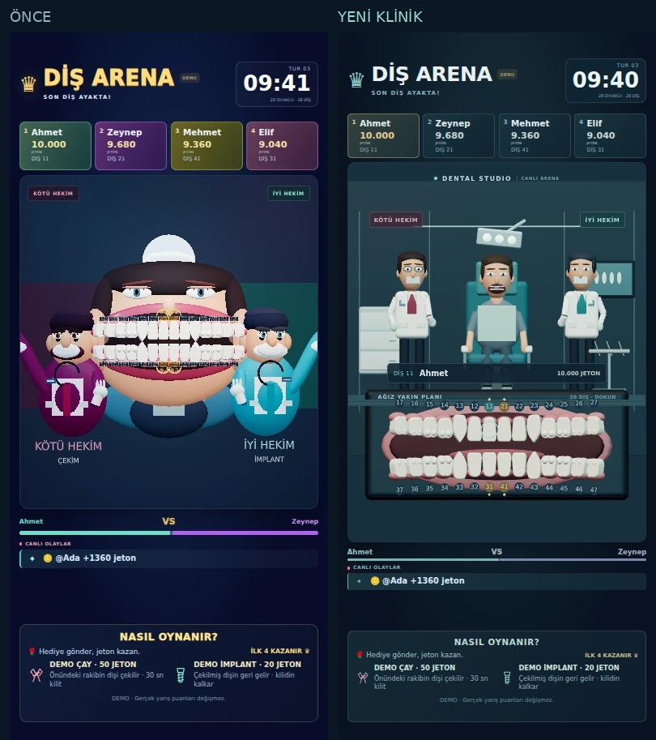

# Diş Arena — klinik görünümü

15 Kasım 2026 · uygulama kaynağı `81bcea2f10a52fb8b12def90763172464d8f531d` · mevcut PR #1.

Kullanıcı önceki görünümü yetersiz buldu. Görsel katman yeniden kuruldu; motor, hediye kuralları, yetki ve kayıt mimarisi değişmedi.

## Yeni sahne

- Koltukta normal oranlı hasta; gövde, önlük ve pantolonlarıyla ayakta iki hekim.
- Çalışan eklemli kol ve hastanın gerçek ağız hedefine yaklaşma.
- Büyütülmüş ağız yakın planında aynı 28 diş, aynı çekim/implant olayı ve aynı hedef.
- İsim/puan levhalarının yerine FDI numarası; dişe dokununca ayrı oyuncu kartı.
- Muayene lambası, dolaplar, alet sehpası ve klinik arka planı.
- Daha sakin lacivert/porselen/turkuaz yayın paleti; altın vurgusu ilk dörtte.



[393×873 mobil](screenshots/mobile.webp) · [360×800 mobil](screenshots/mobile-360.webp) · [1080×1920 OBS](screenshots/obs.webp) · [Çekim](screenshots/extract.webp) · [İmplant](screenshots/implant.webp) · [Dişe dokunma](screenshots/tooth-inspector.webp)

Bunlar gerçek Chromium WebGL ekran yakalamalarıdır; üretim görseli veya video değildir. PNG asılları Actions artifact `14172650178`, WebP kopyaları bu depodadır. Önce/sonra yalnız iki gerçek yakalamanın yan yana yerleştirilmesidir.

## Doğrulama

64 güncel motor/sunucu/koordinat testi ve üretim build geçti. 6 gerçek Chromium kabul testi; 360×800, 393×873, 1080×1920 ve masaüstü render, taşma, tam ekran, şifre/rol ayrımı ve dört demo işlemi geçti. 17 numaralı dişe gerçek tıklama doğru oyuncu kartını açtı. Hasta ve yakın planın dünya koordinatı dönüşümleri ayrıca test edilir.

Üç iş akışı başarılı:

- [Diş Arena CI](https://github.com/dentalaidestek/dis-arena-live-/actions/runs/43740889063)
- [Verify Diş Arena](https://github.com/dentalaidestek/dis-arena-live-/actions/runs/43740889040)
- [Tarayıcı kabul](https://github.com/dentalaidestek/dis-arena-live-/actions/runs/43740889022)

Karakterler hâlâ prosedürel/stilizedir; yüksek bütçeli sanatçı karakterleri olarak sunulmaz. Gerçek Android GPU/Termux ve aktif TikTok LIVE kabulü yapılmadı; önceki [açık kabul işleri](ACCEPTANCE.md) sürüyor. Main merge veya production dağıtımı yok.

## Telefonda güncelle

Sunucu açıksa Ctrl+C ile durdurun:

```sh
cd ~/dis-arena-live-
git pull --ff-only
bash termux-preview.sh
```

Yayıncı panelinden oyun ekranını açın veya `/demo` adresine gidin. İlgili dişe dokunarak oyuncu kartını açabilirsiniz.
